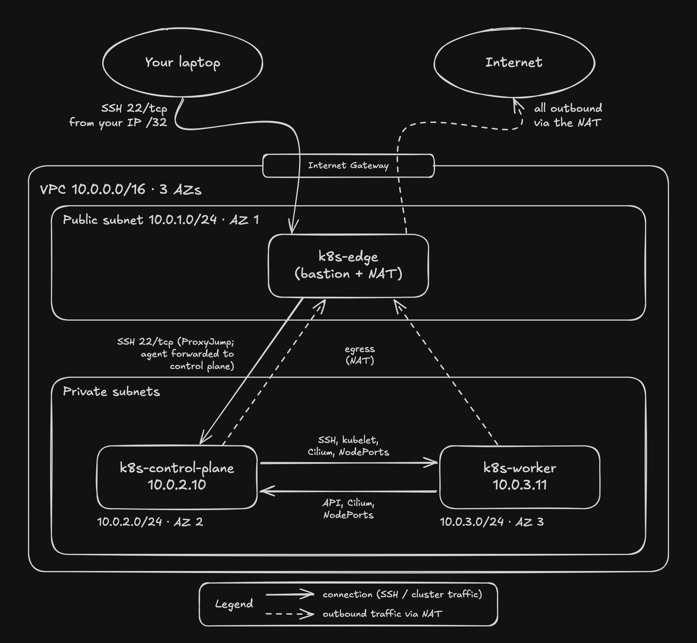
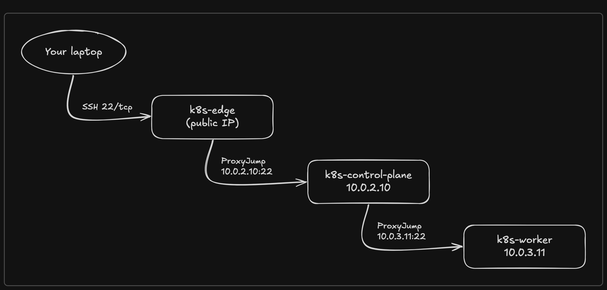

# Lab: build, use and tear down

The private two-node kubeadm lab from [Post 1](../posts/01-private-k8s-lab-on-aws.md), which explains the
design. This page is the how-to. Run every command from the repo root.

**Prerequisites:** an AWS account, AWS CLI v2 with credentials configured (the lab uses `us-east-1`; set `TF_VAR_region` to change it), OpenTofu ≥ 1.6 (the scripts call `tofu`; the `.tf` files also work with Terraform ≥ 1.5, whose `init` adds its own registry's hashes to `.terraform.lock.hcl`), OpenSSH (`ssh`, `ssh-keygen`) and `curl` (all preinstalled on macOS). The credentials need to manage EC2: everything the lab creates (instances, VPC networking, security groups, key pair) is an EC2 API, so `ec2:*` in the region, or the AWS managed policy `AmazonEC2FullAccess`, is enough. You don't need an existing SSH key: the lab creates its own. To use a different key, set `LAB_SSH_KEY=/absolute/path/to/key` before the first `lab-start.sh` (use an absolute path: the [rebuild commands](#rebuild-one-instance) run `tofu` from `infra/`): keep it set for every later command, `delete` included, because changing the key replaces all three instances, which wipes the cluster. Set `TF_VAR_region` before the first `start`: once the lab exists, `start` and `delete` use the region in the state, so to move a lab, delete it first. Keep it set in later shells anyway, because with no state to read (a lost state file) the scripts look only in that region or `us-east-1`, and can miss a lab that's still billing.

## Architecture



SSH goes from your laptop to the edge, then the control plane, then the worker:



## What's here

```text
infra/
├── README.md             # this file
├── diagrams/             # the network and SSH path images above
├── providers.tf          # AWS provider; every resource tagged Project = cks-lab
├── variables.tf          # region, your IP (/32 only), Kubernetes version, lab key path
├── key_pair.tf           # uploads the lab's public key
├── ami.tf                # latest Ubuntu 24.04 image from Canonical
├── vpc.tf                # VPC, subnets, internet gateway (IGW), route tables (private → edge's network interface, ENI)
├── security.tf           # one security group (SG) per instance, rules as separate resources, empty default SG (table under Design reference)
├── edge.tf               # t3a.nano edge instance (bastion jump host + NAT for outbound internet)
├── kubernetes.tf         # one map of nodes: subnet, IP, availability zone (AZ), SG
├── output.tf             # what the scripts read: region, instance IDs, node list, node IPs, Kubernetes version
├── .terraform.lock.hcl   # pins the exact provider build
└── scripts/
    ├── nat.sh            # edge first boot: IP forwarding + masquerade, restored on every boot
    ├── node.sh           # node first boot: hostname + /etc/hosts, swap off, kernel modules and sysctls, containerd 2.x (systemd cgroups), crictl, git, kubeadm/kubelet/kubectl pinned to one patch release and held
    ├── lib.sh            # helpers shared by the lab scripts
    ├── lab.sh            # lab console: start | init | stop | delete | status | ssh | help
    ├── lab-start.sh      # build/start the lab, write infra/ssh_config, check first boot (lab.sh start)
    ├── lab-stop.sh       # stop the instances (lab.sh stop)
    ├── cluster-init.sh   # optional: kubeadm init, Cilium and join in one go (sections 3–5)
    └── replay.sh         # replay.sh [NN] [REF]: cluster-init, then every post folder below NN, cloned from GitHub at REF
```

Generated in `infra/`, not committed: `ssh_config`, `known_hosts`, `terraform.tfstate`, `.terraform/`, and `.rebuilt` while a rebuild's host key cleanup is pending.

Worth knowing when you read the code:

- **Instances ignore changes to `ami` and `user_data`.** A new Ubuntu image or an edited `node.sh` never replaces a node behind your back; upgrades go through kubeadm. To apply an edited script on purpose, replace that instance ([Rebuild one instance](#rebuild-one-instance)). Until you do, every plan ends with a `boot_scripts_applied` warning naming the instance.
- **`node.sh` stops short of `kubeadm init`.** Running it yourself is part of the practice.
- **The lab's SSH config is generated, not hand-edited.** The edge gets a new public IP on every start, so `lab-start.sh` rewrites `infra/ssh_config` each run, with one `Host` block per node from the tofu outputs. Adding a node starts with one more entry in the `nodes` map in `kubernetes.tf`, plus its SG rules in `security.tf`. The config also reuses connections (`ControlMaster`), so after the first `ssh` to a node, further `ssh` and `scp` skip the handshake on every hop until the connection has been idle for 10 minutes. The reuse sockets go in `~/.ssh/k8s-lab-*`, because paths under `infra/` can exceed the Unix socket length limit; `stop` and `delete` close them, and otherwise they go after those 10 idle minutes.
- **Lab host keys live in `infra/known_hosts`**, never in your `~/.ssh/known_hosts`. A rebuild brings new host keys, so `lab-start.sh` drops the old ones when the instance IDs change, and clears the old worker host keys from the control plane's own `~/.ssh/known_hosts` too, so `ssh`/`scp k8s-worker` from there keep working. Any other host key change stops it with a warning.
- **The Kubernetes version is set in `variables.tf`** (`k8s_minor` and `k8s_patch`, default 1.35.9). To change it, set `TF_VAR_k8s_patch` (and `TF_VAR_k8s_minor` for a new minor release) before the first `start`. Existing nodes ignore the change; they upgrade through kubeadm. Changing either value on an existing lab also makes every plan show the `boot_scripts_applied` warning for both nodes, because the version is part of the rendered `node.sh`.

## 1. Start the lab

```bash
./infra/scripts/lab.sh
```

This opens the lab console, a `cks-lab>` prompt that acts as your base terminal: you start the lab, `ssh` into a node to work, `exit` back to the prompt, and stop or delete the lab at the end. At the prompt, `quit`, `exit` or Ctrl-D asks whether to stop a lab that's still running, and the up arrow recalls earlier commands. Every command also runs on its own, e.g. `./infra/scripts/lab.sh start`:

| Command | Does |
|---|---|
| `start` | Same as `lab-start.sh`: init (once), apply, start the instances, write `infra/ssh_config`, check first boot. Brings up the machines only; with no cluster yet, it ends by listing your two options (see below) |
| `init` | Same as `cluster-init.sh`: sections 3–5 in one go, skipping finished steps. Optional: you can do those sections manually instead |
| `ssh control-plane` / `ssh worker` / `ssh edge` | A shell on that node; `exit` returns to the prompt |
| `status` | Instance states and uptime, and how many nodes are `Ready` (or `Cluster: not built yet` before sections 3–5). On a stopped lab it says that `start` brings it up |
| `help` | A short description of each command (`./infra/scripts/lab.sh help`, `-h` or `--help` outside the console) |
| `stop` | Same as `lab-stop.sh` |
| `delete` | Destroy the lab (section 7) |

`start` on a fresh clone runs `tofu init`, then asks which public IP may SSH to the edge: it looks up your current one (`https://checkip.amazonaws.com`) and offers it as the default, so press Enter to accept it or type another single IPv4 address (behind a VPN or CGNAT, use the address your SSH traffic will come from). The edge's SG rule becomes that IP as a `/32`, refreshed every `start`. Then it runs `tofu apply`: **read the plan** and type `yes` (the first build shows `Plan: 40 to add`). It then starts the instances, writes `infra/ssh_config`, prints `Instances running.`, waits for each instance's first boot (a few minutes on a new lab) and prints `k8s-edge: ready`, `k8s-control-plane: ready`, `k8s-worker: ready` (or `ready, with warnings`, which `sudo cloud-init status --long` explains) and `Lab ready`. Run it at the start of every session. If SSH later times out, your public IP has probably changed (often a VPN): run `start` again to update the rule.

`start` brings up the machines, not the cluster. On a new lab it ends with your two ways to build it:

```text
Lab ready, but there is no cluster yet. Two options:
  1. Build it manually (kubeadm init, Cilium, join): infra/README.md sections 3-5. You see every step.
  2. Type init (lab.sh init) to do all of it in one go.
```

Both give the same cluster. Building it manually is recommended the first time; `init` suits rebuilds, or getting straight to a post's hardening. A stopped lab keeps its cluster, so later sessions need only `start`, which then ends with `Lab ready. lab.sh ssh control-plane opens a shell on the control plane, where kubectl runs.`

`start`, `stop`, `status` and `delete` check AWS for instances tagged `Project=cks-lab` whenever the local state tracks no lab, and refuse to continue if they find any. They don't stop those instances: to stop the billing meanwhile, run `aws ec2 stop-instances` on the IDs the message prints. If they find none, `status` prints `No lab deployed.` and `stop` and `delete` print `No lab found (nothing deployed).` A lost or moved `infra/terraform.tfstate` therefore can't hide a lab that's still billing, or build a second one next to it.

`ssh worker` in the console (or plain `ssh` with the generated config) goes laptop → edge → control plane → worker, because the worker only accepts SSH from the control plane. Every hop is made automatically (`ProxyJump` in `infra/ssh_config`) and your key file never leaves your laptop:

```bash
ssh -F infra/ssh_config k8s-worker   # what lab.sh ssh worker runs
```

## 2. Wait for the first boot

`start` already waited for this. If a node's boot failed, it printed the end of that node's log and exited with an error. To check manually:

```bash
ssh -F infra/ssh_config k8s-control-plane 'cloud-init status --wait'
ssh -F infra/ssh_config k8s-worker 'cloud-init status --wait'
```

Both should print `status: done`, about 3 minutes after launch. `status: error` means `node.sh` failed; `sudo tail -50 /var/log/cloud-init-output.log` on that node shows why.

**Choose your path.** Sections 3–5 bootstrap the cluster manually, so you see every step. To do all three in one go instead (for a rebuild, to skip ahead to the hardening, or to replay earlier posts), run `init` in the console (or `./infra/scripts/cluster-init.sh` from the repo root). It runs the same steps over SSH, with checks between them (the API server answers, the cgroup driver matches, a half-finished join is reset), skips any that are already done, and waits until every node is `Ready`.

## 3. Initialize the control plane

On `k8s-control-plane` (`lab.sh ssh control-plane`), write the kubeadm config file. The guide prefers a config file to flags, and later posts (audit logging, encryption at rest) add to this one:

```bash
cat > kubeadm-config.yaml <<'EOF'
apiVersion: kubeadm.k8s.io/v1beta4
kind: InitConfiguration
localAPIEndpoint:
  advertiseAddress: 10.0.2.10        # the control plane's private IP (on your laptop: tofu -chdir=infra output node_private_ips)
  bindPort: 6443
nodeRegistration:
  name: k8s-control-plane
---
apiVersion: kubeadm.k8s.io/v1beta4
kind: ClusterConfiguration
kubernetesVersion: v1.35.9           # the patch release node.sh installed (on this node: kubeadm version -o short)
controlPlaneEndpoint: k8s-control-plane:6443
networking:
  podSubnet: 192.168.0.0/16
EOF

kubeadm config validate --config kubeadm-config.yaml
sudo kubeadm init --config kubeadm-config.yaml

mkdir -p ~/.kube
sudo cp /etc/kubernetes/admin.conf ~/.kube/config
sudo chown $(id -u):$(id -g) ~/.kube/config
```

What two of the settings are for:

- **`controlPlaneEndpoint`** is a name, not an IP. It resolves through `/etc/hosts`, which `node.sh` writes on both nodes, and the worker joins through it. The guide is explicit that a single control plane built without one can't be turned into a highly available cluster later.
- **`podSubnet`** is the range Cilium hands out pod IPs from (section 4). It must not overlap the VPC (`10.0.0.0/16`) or the Service range (kubeadm's default `10.96.0.0/12`).

Two checks before moving on:

```bash
sudo grep cgroupDriver /var/lib/kubelet/config.yaml    # must say systemd, like containerd (node.sh)
sudo install -d -m 700 /root/break-glass && sudo mv /etc/kubernetes/super-admin.conf /root/break-glass/
```

The kubelet and containerd must use the same cgroup driver, or the kubelet fails. `super-admin.conf` is in the `system:masters` group, which bypasses RBAC entirely; the guide says to move it somewhere safe. Root-only on the node is this lab's version, and Post 3 comes back to it. It guards against accidental use, not against an attacker: the `ubuntu` user has passwordless sudo. Day to day, `admin.conf` (group `kubeadm:cluster-admins`, bound to `cluster-admin` through RBAC) is the admin credential.

## 4. Install Cilium

On the control plane, install the Cilium CLI, checking the download against its published checksum first (Post 2 comes back to verifying binaries). These versions are pinned in `cluster-init.sh` and listed under "Tested with" in `CHANGELOG.md`; change them there and here together:

```bash
CILIUM_CLI_VERSION=v0.20.1
curl -fsSL --remote-name-all https://github.com/cilium/cilium-cli/releases/download/${CILIUM_CLI_VERSION}/cilium-linux-amd64.tar.gz{,.sha256sum}
sha256sum --check cilium-linux-amd64.tar.gz.sha256sum \
  && sudo tar xzvfC cilium-linux-amd64.tar.gz /usr/local/bin \
  && rm cilium-linux-amd64.tar.gz{,.sha256sum}

cilium install --version 1.20.4 --set ipam.mode=kubernetes
cilium status --wait
```

`ipam.mode=kubernetes` makes Cilium hand out pod IPs from kubeadm's `podSubnet` (`192.168.0.0/16`, set in section 3). Cilium's own default pool is `10.0.0.0/8`, which overlaps the VPC. Between the nodes, Cilium wraps pod traffic in VXLAN (UDP 8472), which the node SGs already allow.

## 5. Join the worker

On `k8s-worker`, run the `kubeadm join ...` command that `kubeadm init` printed, with `sudo`. It carries a bootstrap token, which is a secret valid for 24 hours, plus the CA certificate hash the worker uses to check it's talking to the right control plane. For a shorter exposure, or if you lost it or it expired, print a new one on the control plane with `sudo kubeadm token create --ttl 15m --print-join-command` and run that instead (`cluster-init.sh` always does this). Then, on the control plane:

```bash
cilium status --wait     # Cilium OK on 2/2 nodes
kubectl get nodes -o wide
```

Both nodes should be `Ready`, named `k8s-control-plane` and `k8s-worker`. In `kubectl get pods -A -o wide`, CoreDNS has `192.168.x.x` IPs; static and hostNetwork pods (etcd, the API server, kube-proxy, the Cilium agent) show the node IPs, `10.0.2.10` and `10.0.3.11`.

## 6. Working on the cluster

The control plane is the lab's admin host, like the jumpbox in Kubernetes the Hard Way: `kubectl` runs there (`lab.sh ssh control-plane`) and always matches the cluster's version, files come to it from GitHub, and from there they go on to the worker. The API server is never reachable from outside the VPC; nothing forwards port 6443 to your laptop. Install anything else a post needs (`helm`, for example) on the control plane too.

`lab.sh ssh control-plane` forwards your SSH agent to the control plane (and only there), so `ssh k8s-worker` and `scp … k8s-worker:` work from a shell on it, while the key itself stays on your laptop. That needs a running agent: `lab.sh ssh control-plane` adds the lab key to it if it's missing (asking for the passphrase once). With plain `ssh -F infra/ssh_config`, add it yourself: `ssh-add ~/.ssh/k8s-hardening-lab_ed25519` (or your `LAB_SSH_KEY`). While you're connected, root on the control plane can use every key loaded in your agent, not only the lab key. Load only the lab key while you work. `ssh-add -c` makes each use ask for confirmation, but it needs an `ssh-askpass` program, which macOS doesn't include. Post 6 covers the alternatives.

From Post 2, each post's files are in `manifests/NN-topic/`: on the control plane you `git clone` the repo at the post's tag, run the folder there, and `scp` it on to the worker. [`manifests/README.md`](../manifests/README.md) has the exact steps and what's in each folder.

To bring a lab to the state before post NN in one go, run `./infra/scripts/replay.sh NN` from the repo root. It runs `init`, then those steps for every post folder numbered below NN. Without NN it replays every folder. The repo is cloned from GitHub at `main`, or at the branch or tag you pass as a second argument (`replay.sh 05 ep05`), so only pushed commits are replayed.

The lab must be running, and you need a running ssh-agent (`eval "$(ssh-agent)"`); `replay.sh` adds the lab key to it, asking for the passphrase once. It deletes and re-clones `~/replay` on the control plane on each run, so do hand work in another clone. To replay from a fork, set `LAB_REPO_URL=https://github.com/YOU/k8s-hardening-lab.git`. Post 4 is a runbook that `replay.sh` can't do: see [`manifests/README.md`](../manifests/README.md).

## 7. Stop it, or destroy it

```bash
./infra/scripts/lab.sh stop   # or: ./infra/scripts/lab-stop.sh
```

It stops the instances and waits until they've stopped. You now pay only for storage, about $4/month.

**Done with the lab?** Delete it, then optionally delete the lab key:

```bash
./infra/scripts/lab.sh delete
rm ~/.ssh/k8s-hardening-lab_ed25519 ~/.ssh/k8s-hardening-lab_ed25519.pub
```

`delete` runs `tofu destroy`: **read the plan** (every resource, `40 to destroy`) and type `yes`. It then removes `infra/ssh_config` and `infra/known_hosts`. It needs the lab key's `.pub` (the variable check in `variables.tf` looks for it), so delete the key only afterwards; if you set `LAB_SSH_KEY`, delete that key instead. The state file lives in `infra/`, so always delete the lab before you move or delete the repo.

### Rebuild one instance

To apply an edited `nat.sh` or `node.sh`, or to start one machine over, replace just that instance. From the repo root:

```bash
# The edge:
tofu -chdir=infra apply -replace=aws_instance.edge \
  -var="my_ip_cidr=$(curl -fsS https://checkip.amazonaws.com)/32"
# Or a node:
tofu -chdir=infra apply -replace='aws_instance.node["k8s-worker"]' \
  -var="my_ip_cidr=$(curl -fsS https://checkip.amazonaws.com)/32"
```

- **Behind a VPN or CGNAT,** put the IP you gave `start` in place of the `curl` lookup, or the edge's SSH rule moves to the wrong address.
- **If you set `LAB_SSH_KEY`,** also pass `-var="ssh_public_key_path=$LAB_SSH_KEY.pub"`, or the key pair changes and all three instances are replaced.
- **Read the plan:** it should replace only the instance you named.

Then run `start`. It writes a fresh `infra/ssh_config` (a new edge has a new public IP), drops the old host keys, and clears the old worker host keys from the control plane. What else to do depends on what you rebuilt:

| Rebuilt | The cluster | Next |
|---|---|---|
| Edge | Untouched (the nodes only lose internet access during the rebuild) | Nothing |
| Worker | Still lists the old `k8s-worker`, now `NotReady` | `init`: it deletes the stale node and joins the new instance. Manually: on the control plane, `kubectl delete node k8s-worker`, then section 5 |
| Control plane | Gone: etcd lived on it | `init`, or sections 3–5 manually. The worker still holds the old cluster's join: `init` resets it; manually, run `sudo kubeadm reset -f` on the worker before joining |

## Costs

Approximate us-east-1 on-demand prices; check the AWS pricing pages for your region.

| Item | Rate | 40 lab hours/month | Fully stopped |
|---|---|---|---|
| 2× t3a.medium | ~$0.0376/hr each | ~$3.00 | $0 |
| 1× t3a.nano (edge: bastion + NAT) | ~$0.0047/hr, plus cents of unlimited-mode credits at most | ~$0.19 | $0 |
| Public IPv4 (edge) | $0.005/hr while running | ~$0.20 | $0 (released on stop) |
| gp3 EBS, 48 GB encrypted | ~$0.08/GB-month | ~$3.84 | ~$3.84 |
| Data transfer and cross-AZ traffic | image pulls mostly free inbound; ~$0.01/GB cross-AZ | ~cents | $0 |
| **Total** | | **~$7–8/month** | **~$4/month** |

Run `stop` (or `lab-stop.sh`) at the end of every session: a lab left running all day costs about $2.

## Design reference

Post 1 explains why the lab looks like this. The details are here.

### Security groups

Each instance has its own security group, and together they allow exactly these flows:

| From → to | Allowed |
|---|---|
| Laptop → edge | 22/tcp, from your IP `/32` only |
| Edge → control plane | 22/tcp |
| Control plane → worker | 22/tcp (the SSH hop), 10250/tcp (kubelet), Cilium (8472/udp VXLAN, 4240/tcp + ICMP health, 4244/tcp Hubble), NodePorts (30000–32767/tcp) |
| Worker → control plane | 6443/tcp (API server), Cilium (same ports), NodePorts |
| Edge → worker | Nothing |
| Nodes → edge | Everything (the NAT path), routed on to the internet |

The node rules follow the Kubernetes "Ports and Protocols" list and Cilium's firewall requirements. The worker can't reach the control plane's SSH, and nothing opens 6443 to the edge or beyond: `kubectl` runs on the control plane, so the API server is only ever reached from inside the VPC. The VPC's default security group has no rules.

The edge masquerades the whole VPC CIDR and doesn't filter what it forwards, so nodes and pods can reach any internet host. That's deliberate for now: Post 5 tightens it.

### Instances

| Role | Type | Why |
|---|---|---|
| Control plane | `t3a.medium` (2 vCPU / 4 GiB) | kubeadm needs 2 CPUs and ~1.7 GB RAM; 4 GiB leaves headroom for Cilium, Falco and friends |
| Worker | `t3a.medium` | Same, so workloads and security tooling fit comfortably |
| Edge (bastion + NAT) | `t3a.nano` | Only forwards SSH and packets |

- **x86_64**, so image tags and tools behave as they do in the CKS exam environment.
- **CPU credits:** standard on the nodes (no surprise credit bill; a long session can be throttled), unlimited on the edge (in standard mode a T3a starts with no credits, which made the edge's first boot take minutes; a box that only forwards packets stays well below its baseline).
- **Encrypted gp3 root volumes:** 20 GB per node, 8 GB for the edge.
- **IMDSv2 required with hop limit 1** on every instance.

### Availability zones and IPs

OpenTofu asks AWS which AZs in the region offer both instance types and uses the first three, so the code isn't tied to `us-east-1a/b/c`. The edge is in the first (public subnet `10.0.1.0/24`), the control plane in the second (`10.0.2.0/24`, static IP `10.0.2.10`) and the worker in the third (`10.0.3.0/24`, `10.0.3.11`). The static IPs keep the SSH config and `kubeadm` commands predictable.

### Verifying the host keys

`ssh_config` accepts each lab host key on first use (`StrictHostKeyChecking accept-new`). To check them properly, compare what your laptop stored with what each instance printed to its console. cloud-init prints the fingerprints on first boot, so do this right after the first `lab-start.sh`:

```bash
REGION=$(tofu -chdir=infra output -raw region)
for id in $(tofu -chdir=infra output -raw instance_ids); do # edge, control plane, worker
  aws ec2 get-console-output --region "$REGION" --instance-id "$id" --output text |
    grep -A6 'BEGIN SSH HOST KEY FINGERPRINTS'
done
ssh-keygen -lf infra/known_hosts # what your laptop trusted
```

Every fingerprint in `infra/known_hosts` should appear in the console output.

---
